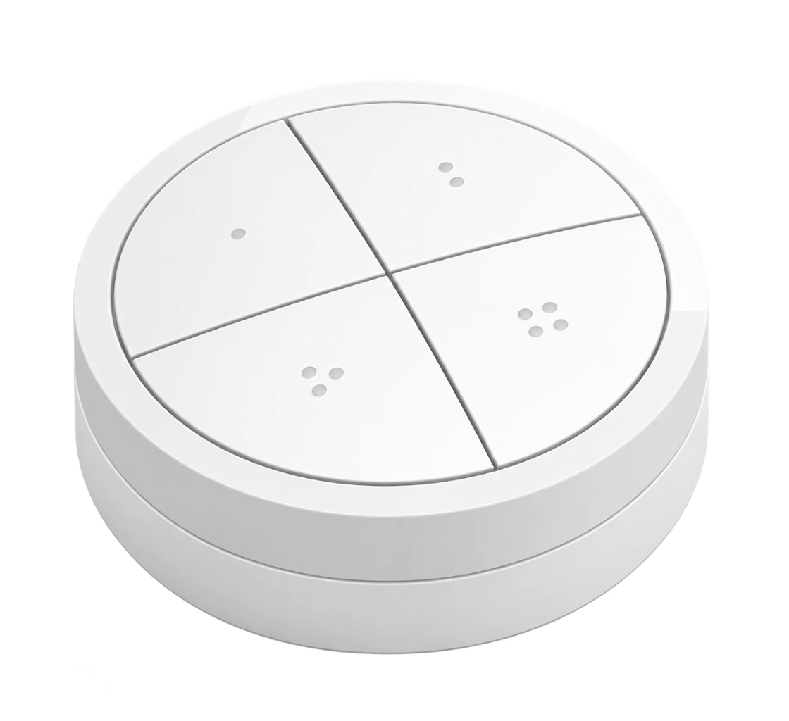

# DialCaptain

### A real dial for Roon, BluOS and WiiM

**English** · [Deutsch](README.de.md)

**[Project page](docs/index.html)** · **[Complete guide](docs/guide/index.html)** · **[Enclosure STL files](docs/downloads/enclosure/)**

DialCaptain connects a **Philips Hue Tap Dial RDM002** to an
**ESP32-C6 Zero with 8 MB**. Turn the ring for volume and configure four
buttons with short and long actions. One control mode is active at a time;
the other profiles keep their settings.

- **Roon:** zone, playback and volume, plus three favourites selected from
  playlists or My Live Radio. Configure through the extension's settings gear.
- **BluOS:** choose a network player, control playback and assign its stored presets.
- **WiiM:** choose your player and WiiM Home presets; explicitly enable its
  own volume control if you want to use the ring.

The Tap Dial remains battery powered. The ESP needs continuous USB power.
No Hue Bridge, RoonPilot or extra computer service is needed. Roon mode still
needs Roon Server; BluOS and WiiM connect directly to the player.
DialCaptain sends control commands and does not play audio itself.

## Setup

The complete guide explains USB installation, Wi-Fi, Roon Server selection,
first Tap Dial pairing, the three control modes and file backup/restoration.
Activate web configuration when needed: by default, hold button 4 for eight
seconds and release, or hold BOOT on the running ESP for three seconds.
Amber blinking indicates an active web server. It closes after ten minutes
without interaction; audio control continues.

## Project-page status

The English/German project pages are being prepared. There is no public
DialCaptain release or approved online installer yet. This repository contains
only project pages, user guides, images and enclosure STL files. It contains
no firmware sources/downloads, tests, development tools or program internals.

## Enclosure

The STL drafts contain a case, lid and two foot variants. Print one case,
one lid and four feet of your chosen type, check fit and prepare the files
in your own slicer. Printer-specific G-code is not distributed.

## Questions and support

Please report questions and problems in [GitHub Issues](https://github.com/mermayer/DialCaptain/issues)
with the version, mode and exact error. Keep backup files and Wi-Fi credentials private.

A hobby project by Senior Coder. Entirely optional support:
[Send Me a Coffee](https://buy.stripe.com/6oU3cw0eV0hC5nbdlX2Fa00) · [Buy Me a Coffee](https://buymeacoffee.com/mermayer).
